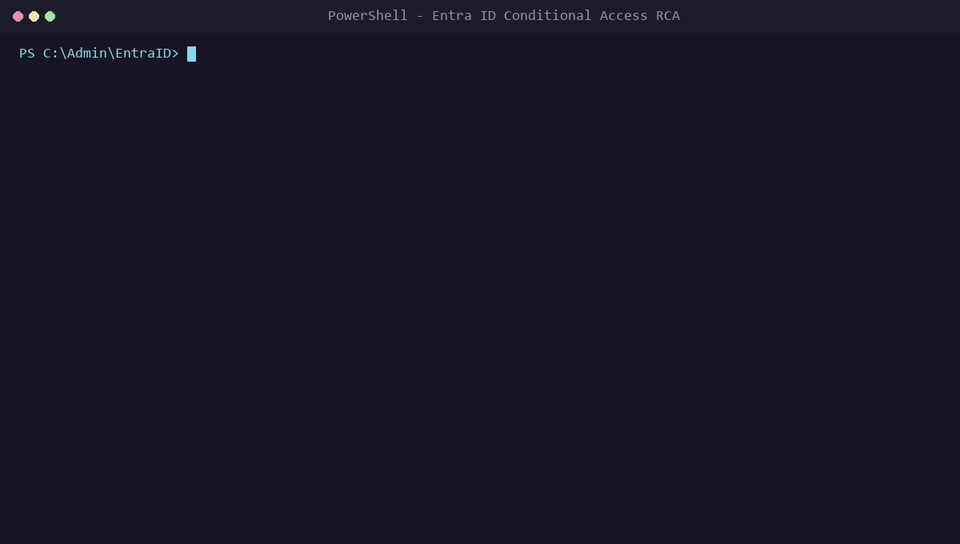

# Entra ID Conditional Access & Sign-In RCA (`entra-signin-rca`)

[](LICENSE)
[](https://www.python.org/)
[](https://agentskills.io)
[](tests/validate-skill.py)

An autonomous AI Agent Skill and zero-dependency diagnostic toolkit for Microsoft 365 and IAM administrators. Evaluates exported Microsoft Entra ID (Azure AD) Sign-In JSON logs and live Microsoft Graph telemetry to determine why a user was blocked, prompted for unexpected MFA, or caught in Conditional Access loops.



---

## Key Features at a Glance

* **Sub-Second Telemetry Triage:** Parses multi-megabyte sign-in logs and evaluates dozens of overlapping Conditional Access policies in under 0.2 seconds without external API calls.
* **Deterministic Anomaly Engine:** Automatically isolates the exact root cause—flagging missing browser SSO extensions, dual-stack IPv6 carrier transitions, authentication strength mismatches, and legacy protocol usage.
* **Zero-Leakage Privacy Sanitizer (`--sanitize`):** Automatically performs SHA-256 masking on User Principal Names (`user-xxxx@corp.example.com`), obfuscates public/private IP addresses, redacts device names, and zeros out GUIDs before any data is passed to an AI model.
* **Dual-Track Remediation:** Delivers two independent resolution paths:
  1. *Client-Side Fix:* How to fix the user's laptop immediately with **zero changes to company security policies**.
  2. *Policy Architecture Fix:* If the rule itself is flawed, provides the exact condition adjustment along with mandatory safeguards (verifying Break-Glass emergency accounts and testing in Report-Only mode first).
* **Zero External Dependencies:** Built with pure Python standard library modules (`json`, `hashlib`, `argparse`) and native PowerShell. Requires no `pip install` and triggers zero endpoint detection (EDR) alerts.
* **Dual Ingestion (Graph One-Liner or JSON File):** Query the affected user's latest failed sign-in directly from Microsoft Graph via a single PowerShell line, or drag and drop exported JSON logs.
* **Automated Verification Harness:** Includes 4 synthetic test fixtures and an automated test runner (`tests/validate-skill.py`) verifying 7/7 test suites with 100% pass rate.

---

## Comparison: What Exists vs. What We Built

| Feature / Capability | Microsoft Native Tools (Portal & What-If) | Existing Community Tools (`greybeard`, `azure-sensei`) | Raw ChatGPT / Copilot Prompts | **What We Built (`entra-signin-rca`)** |
| --- | --- | --- | --- | --- |
| **Real vs. Hypothetical Data** | "What If" only simulates hypothetical rules against static attributes. | General chat/admin only; no log parser. | Only analyzes what raw text you paste in. | **Analyzes actual runtime telemetry** captured at the moment of failure. |
| **Data Privacy & Compliance** | Kept in Azure, but hard to share with tier-1 techs. | Requires connecting live admin API tokens. | **High Risk:** Pasting raw logs leaks user emails, IPs, and tenant IDs. | **Zero-Leakage Sanitizer (`--sanitize`):** Masks all PII, emails, and IPs locally *before* AI analysis. |
| **Detection of Hidden Traps** | **Hidden in JSON:** Admin must manually check 150+ lines across tabs. | Cannot detect. | Guesses or suggests broad troubleshooting steps. | **Deterministic Heuristics:** Instantly flags Chrome PRT loss, IPv6 carrier routing, and auth strength mismatches. |
| **Speed to Root Cause** | 15–30 minutes of manual log inspection per ticket. | N/A (cannot parse logs). | 5–10 minutes of prompt crafting and re-prompting. | **Under 1 second** (`0.12s` execution time). |
| **Remediation Safety** | Gives no remediation; only shows raw policy names. | Suggests general commands without safety checks. | Often suggests dangerous workarounds (e.g. *"exclude user from policy"*). | **Dual Remediation Paths:** Mandates Break-Glass exclusions and Report-Only validation before applying changes. |
| **Cost & Dependencies** | Requires Entra ID P1/P2 license and portal access. | Requires complex local environments or API keys. | Requires paid subscriptions ($20–$30/mo/user). | **$0 Cost, Zero Dependencies:** Runs on standard Python/PowerShell; works offline with Ollama or free LLMs. |

---

## Core Anomaly Detections

The bundled parser (`scripts/parse-entra-signin.py`) automatically flags the top 5 real-world identity failure modes:

| Diagnostic Code | Failure Pattern | Technical Root Cause |
| --- | --- | --- |
| `MISSING_PRT_OR_SSO_EXTENSION` | Chrome / Firefox Unregistered Device Illusion | Device is compliant in Intune, but user signed in via Chrome or Firefox without the Windows Accounts extension (or in Incognito). Device ID is blank, failing `compliantDevice` grant controls. |
| `IPV6_NAMED_LOCATION_MISMATCH` | Dual-Stack Carrier Routing Block | Corporate Named Location defines only IPv4 CIDRs (`198.51.100.0/24`). ISP routes client traffic over IPv6, causing Entra to evaluate the connection as "Untrusted / Outside Corporate Network". |
| `AUTHENTICATION_STRENGTH_MISMATCH` | Phishing-Resistant MFA Requirement (`530034`) | Policy requires FIDO2 / Windows Hello for Business / Passkey, but user only enrolled SMS or Microsoft Authenticator Push. |
| `DEVICE_COMPLIANCE_DRIFT` | Registered Endpoint Out of Compliance | Device ID is present, but `isCompliant` evaluates to `false` due to BitLocker encryption failure, overdue Intune check-in, or OS version requirements. |
| `LEGACY_AUTHENTICATION_PROTOCOL` | Basic Auth Protocol Block | Client connects via Exchange ActiveSync, IMAP4, or POP3, which cannot satisfy interactive MFA or device compliance checks. |

---

## Installation & Setup Guide

### 1. Prerequisites
* **Operating System:** Windows, macOS, or Linux
* **Python Runtime:** Python 3.9 or newer (installed with standard library; verify with `python --version`)
* **Zero Dependencies:** No third-party packages or virtual environments required (no `pip install` needed)
* **Optional (for live tenant queries):** PowerShell 5.1+ and the read-only `Microsoft.Graph.Authentication` module

### 2. Getting the Repository

#### Option A: Clone with Git (Recommended)
```bash
git clone https://github.com/ToritsejuBoyo/entra-signin-rca.git
cd entra-signin-rca
```

#### Option B: Download Standalone Parser (Zero Repo Footprint)
If you only need the local telemetry parser on a jump box or technician workstation:
```powershell
curl.exe -L -o parse-entra-signin.py https://raw.githubusercontent.com/ToritsejuBoyo/entra-signin-rca/main/scripts/parse-entra-signin.py
```

### 3. Verify Your Installation
Run the built-in automated test suite to confirm your Python environment handles all heuristics and sanitization rules:
```bash
python tests/validate-skill.py
```
If you see `ALL TESTS PASSED (7/7 suites successful)`, the tool is ready for production use.

### 4. Installing as an AI Agent Skill (`agentskills.io`)
To make this skill available to your autonomous coding or operations agent:
* **Google Antigravity:** Place or symlink the folder into `~/.gemini/skills/entra-signin-rca/`
* **Cursor / Windsurf / VS Code Agents:** Place into `.cursor/skills/entra-signin-rca/` or your workspace root
* **Claude / ChatGPT / Ollama (Offline Web UI):** Paste the contents of `SKILL.md` as custom system instructions or reference it directly.

---

## Quick Start

### Method 1: Direct Microsoft Graph One-Liner (Fastest)

Query the affected user's most recent failed sign-in and pipe directly to the local parser without saving credentials or raw files:

```powershell
Connect-MgGraph -Scopes "AuditLog.Read.All" -NoWelcome
Get-MgAuditLogSignIn -Filter "userPrincipalName eq 'user@contoso.com' and status/errorCode ne 0" -Top 1 |
    ConvertTo-Json -Depth 6 |
    python scripts/parse-entra-signin.py -i - --sanitize --format markdown
```

### Method 2: Local File Parsing

Export sign-in logs from **Microsoft Entra Admin Center -> Identity -> Monitoring & health -> Sign-in logs -> Download JSON**, then run:

```bash
# Generate compact sanitized markdown summary
python scripts/parse-entra-signin.py --input SignIns.json --sanitize --format markdown

# Generate structured JSON for automation pipelines
python scripts/parse-entra-signin.py --input SignIns.json --sanitize --format json --output triage.json
```

### Method 3: AI Agent Integration (`agentskills.io`)

Instruct your AI coding assistant or operations agent:

```text
Analyze this Entra sign-in failure using the entra-signin-rca skill:
1. Parse the attached SignIns.json log using scripts/parse-entra-signin.py --sanitize.
2. Cross-reference the failing policy with references/entra-error-codes-and-ca-controls.md.
3. Recommend two remediation paths:
   - Endpoint/Client-side fix (zero policy changes).
   - Safe policy architecture fix (with break-glass exclusions and report-only validation).
4. Output the result in assets/ca-lockout-rca-report-template.md format.
```

---

## Repository Structure

```text
entra-signin-rca/
├── SKILL.md                                 # Canonical agent skill definition (agentskills.io)
├── README.md                                # Project overview, quickstart, and documentation
├── LICENSE                                  # MIT License
├── scripts/
│   └── parse-entra-signin.py                # Zero-dependency Entra sign-in JSON parser
├── references/
│   └── entra-error-codes-and-ca-controls.md # Comprehensive AADSTS error and CA control matrix
├── assets/
│   ├── demo.gif                             # Animated terminal walkthrough
│   ├── demo.mp4                             # High-definition MP4 recording
│   └── ca-lockout-rca-report-template.md    # Standard IAM Root Cause Analysis report template
└── tests/
    ├── validate-skill.py                    # Automated test suite (7 suites)
    └── fixtures/
        ├── fixture-ca-device-not-compliant.json
        ├── fixture-ca-ipv6-named-location-block.json
        ├── fixture-ca-auth-strength-mismatch.json
        └── fixture-ca-legacy-auth-block.json
```

> [!NOTE]
> All files in `tests/fixtures/` use 100% synthetic mock identities (e.g., `mock-user-01@synthetic-test.local`) and IANA reserved documentation IP ranges (RFC 5737). Zero real credentials, passwords, or tenant secrets exist in this repository.

---

## Automated Verification

This skill includes an automated test harness validating parser accuracy, anomaly detection heuristics, and PII sanitization across all synthetic fixtures:

```bash
python tests/validate-skill.py
```

Expected output:
```text
============================================================
Running Automated Test Suite for entra-signin-rca
============================================================
[PASS] Fixture 1: Device Compliance & Missing PRT in Browser verified.
[PASS] Fixture 2: IPv6 Named Location Mismatch verified.
[PASS] Fixture 3: Authentication Strength Mismatch verified.
[PASS] Fixture 4: Legacy Authentication Protocol Block verified.
[PASS] Sanitization Integrity: PII and telemetry identifiers fully masked.
[PASS] Markdown Output: Structured report generated cleanly.
[PASS] Stdin Pipeline: Piped data stream parsed successfully.
============================================================
ALL TESTS PASSED (7/7 suites successful)
============================================================
```

---

## Security & Privacy Guardrails

1. **Zero-Trust Remediation Priority:** The skill always presents endpoint remediation options before recommending policy changes. Disabling security policies or creating permanent broad user exclusions is strictly disallowed.
2. **Break-Glass Hygiene:** Recommended policy modifications mandate verifying at least two cloud-only Emergency Access (`*.onmicrosoft.com`) accounts are excluded, and testing in **Report-only** mode first.
3. **PII Sanitization:** The `--sanitize` option performs SHA-256 masking on UserPrincipalNames, obfuscates public IPv4/IPv6 addresses, redacts device display names, and zeros out GUIDs (TenantId, CorrelationId, DeviceId, PolicyId).

---

## License

This project is licensed under the [MIT License](LICENSE). Copyright (c) 2026 Boyo Toritseju.
